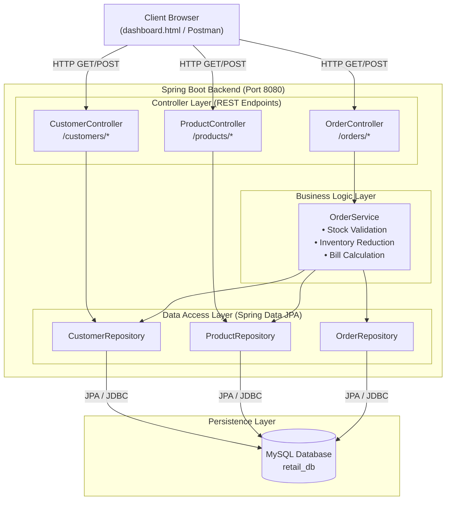
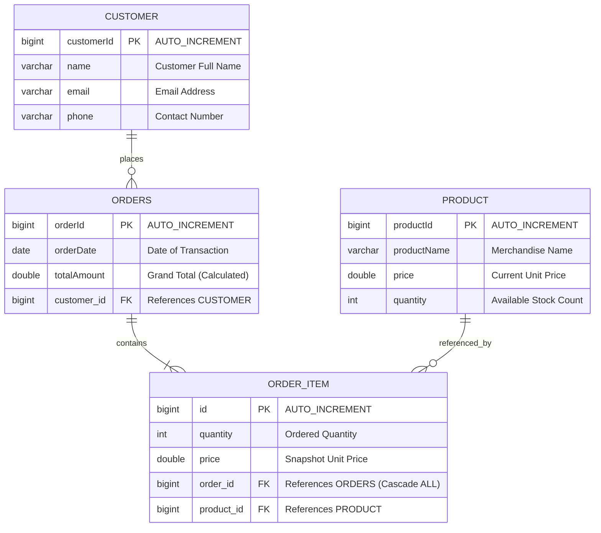
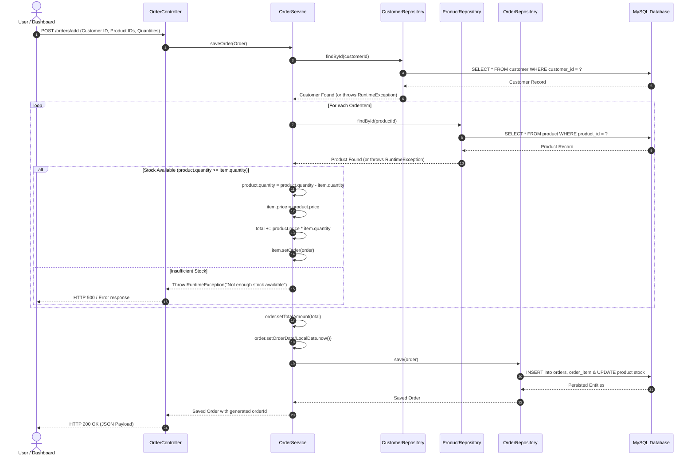
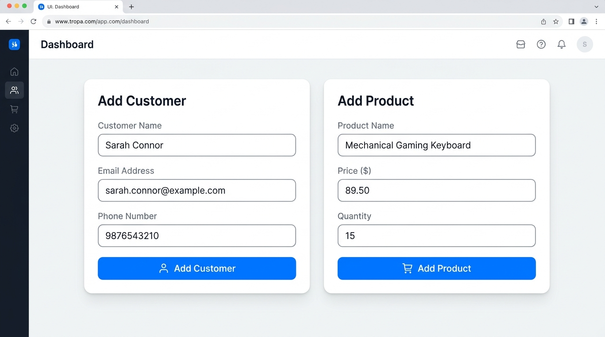
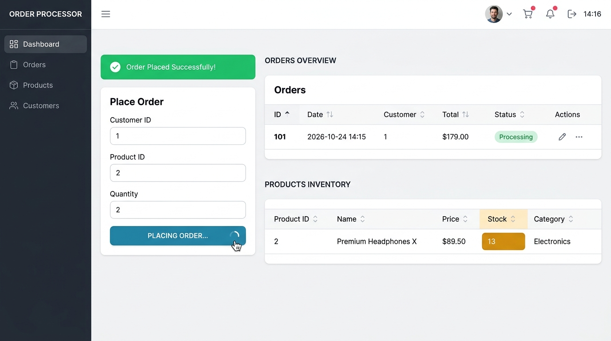
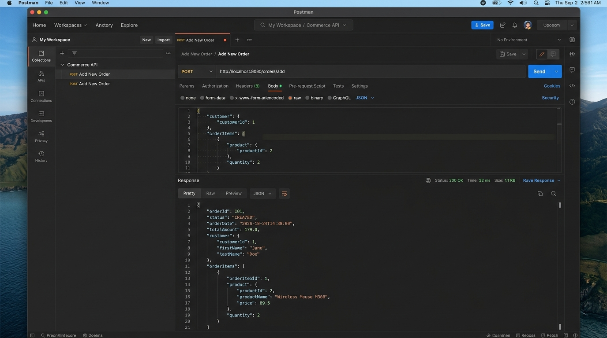

# 🛍️ Retail Store Management System

[](https://www.oracle.com/java/technologies/javase/jdk17-archive-downloads.html)
[](https://spring.io/projects/spring-boot)
[](https://spring.io/projects/spring-data-jpa)
[](https://www.mysql.com/)
[](https://maven.apache.org/)
[](LICENSE)
[]()

> A robust, full-stack **Retail Store Management System** built with **Java 17**, **Spring Boot 4**, **Spring Data JPA (Hibernate)**, **MySQL**, and a responsive **HTML5/CSS3/JavaScript SPA Dashboard**. The system streamlines retail point-of-sale operations, customer relationship records, real-time inventory tracking, and automated multi-item order processing with stock validation.

---

## 📑 Table of Contents

- [📌 Project Overview](#-project-overview)
  - [The Problem It Solves](#the-problem-it-solves)
  - [Target Users & Objectives](#target-users--objectives)
  - [Why This Project Matters](#why-this-project-matters)
- [✨ Implemented Features](#-implemented-features)
  - [1. Customer Management](#1-customer-management)
  - [2. Product & Inventory Catalog](#2-product--inventory-catalog)
  - [3. Order Placement & Automated Billing](#3-order-placement--automated-billing)
  - [4. Real-Time Analytics Dashboard](#4-real-time-analytics-dashboard)
- [🛠️ Technology Stack](#️-technology-stack)
- [🏗️ System Architecture & Design](#️-system-architecture--design)
  - [Layered Architecture Diagram](#layered-architecture-diagram)
  - [Entity Relationship Diagram (ERD)](#entity-relationship-diagram-erd)
  - [Order Execution & Stock Deduction Flow](#order-execution--stock-deduction-flow)
- [📂 Project Directory Structure](#-project-directory-structure)
- [🗄️ Database Schema & Persistence](#️-database-schema--persistence)
- [🔗 REST API Specification](#-rest-api-specification)
  - [Customer Endpoints](#customer-endpoints)
  - [Product Endpoints](#product-endpoints)
  - [Order Endpoints](#order-endpoints)
- [🚀 Setup & Execution Guide](#-setup--execution-guide)
  - [Prerequisites](#prerequisites)
  - [Step 1: Clone the Repository](#step-1-clone-the-repository)
  - [Step 2: Configure MySQL Database](#step-2-configure-mysql-database)
  - [Step 3: Update `application.properties`](#step-3-update-applicationproperties)
  - [Step 4: Build the Project](#step-4-build-the-project)
  - [Step 5: Run the Application](#step-5-run-the-application)
  - [Step 6: Access the Dashboard](#step-6-access-the-dashboard)
  - [Importing into Eclipse / IntelliJ IDEA](#importing-into-eclipse--intellij-idea)
- [🖥️ Application Walkthrough & User Guide](#️-application-walkthrough--user-guide)
- [📸 Screenshots & Visual Demonstrations](#-screenshots--visual-demonstrations)
- [🧪 Testing & Verification](#-testing--verification)
- [🔒 Security & Technical Limitations](#-security--technical-limitations)
- [🔮 Roadmap & Future Enhancements](#-roadmap--future-enhancements)
- [🤝 Contributing](#-contributing)
- [📄 License](#-license)
- [👩‍💻 Author & Contact](#-author--contact)

---

## 📌 Project Overview

The **Retail Store Management System** is a cohesive, full-stack enterprise retail application engineered to handle the core workflows of retail stores: customer onboarding, catalog and inventory management, order execution, and sales reporting.

### The Problem It Solves
Small and medium-sized retail businesses frequently struggle with disconnected tools: customer data kept in spreadsheets, inventory tracked manually, and billing calculated on paper or isolated calculators. This causes:
- **Inventory Discrepancies**: Selling items that are physically out of stock.
- **Manual Billing Mistakes**: Incorrect line-item totals and billing mismatches.
- **Lack of Visibility**: Store managers unable to view live metrics on customers, orders, and current inventory.

### Target Users & Objectives
- **Cashiers / Store Clerks**: Quickly register customers, check live product stock, and execute multi-item purchases with automated billing.
- **Inventory & Store Managers**: Track real-time stock levels, add new catalog items, monitor sales volume, and view transaction records.
- **Developers & Evaluators**: Review a clean, idiomatic demonstration of Spring Boot 4 REST architecture, JPA entity relationships, and asynchronous frontend integration.

### Why This Project Matters
This repository demonstrates clean separation of concerns across a 3-tier enterprise architecture:
1. **Presentation Layer**: A lightweight Vanilla HTML5/CSS3/JavaScript SPA served directly through Spring Boot static resources, avoiding heavyweight frontend bundlers while providing instantaneous updates via the Fetch API.
2. **Business / Service Layer**: Robust service classes encapsulating business logic such as inventory checks, real-time stock deductions, and transactional order total calculations.
3. **Persistence Layer**: Declarative Spring Data JPA repositories with relational integrity (One-to-Many, Many-to-One), Jackson circular-reference management (`@JsonManagedReference` / `@JsonBackReference`), and MySQL persistence.

---

## ✨ Implemented Features

Every feature listed below has been verified directly against the repository's source code:

### 1. Customer Management
- **Add Customer**: Register customers with their `name`, `email`, and `phone`.
- **Retrieve All Customers**: Fetch the full list of registered customer records as JSON for customer directories and selection in order processing.
- **Responsible Components**:
  - `Customer.java` (JPA Entity)
  - `CustomerRepository.java` (Spring Data JPA Interface)
  - `CustomerController.java` (`POST /customers/add`, `GET /customers/all`)

### 2. Product & Inventory Catalog
- **Add Product**: Insert catalog merchandise specifying `productName`, unit `price`, and initial stock `quantity`.
- **View Inventory**: Display product details, current pricing, and real-time remaining stock in the dashboard table.
- **Real-Time Stock Updates**: Product stock decreases automatically when orders are successfully placed.
- **Responsible Components**:
  - `Product.java` (JPA Entity)
  - `ProductRepository.java` (Spring Data JPA Interface)
  - `ProductController.java` (`POST /products/add`, `GET /products/all`)

### 3. Order Placement & Automated Billing
- **Multi-Item Order Processing**: Place orders associated with a valid customer and one or more product line items.
- **Stock Availability Verification**: Before finalizing any transaction, the service layer queries the database to ensure `product.getQuantity() >= item.getQuantity()`. If stock is insufficient, the system throws a `RuntimeException("Not enough stock available")`.
- **Dynamic Stock Reduction**: Upon successful validation, the ordered quantity is subtracted from the product's live inventory (`product.setQuantity(...)`).
- **Snapshot Pricing**: Line items capture the current unit price of the product at checkout time (`item.setPrice(product.getPrice())`), insulating past orders from future price modifications.
- **Automated Total Calculation**: Computes the sum of `(unit_price * quantity)` across all order items and writes the grand total to `order.totalAmount`.
- **Automatic Date Stamping**: Assigns the system date (`LocalDate.now()`) to `order.orderDate`.
- **Bidirectional Cascade Persistence**: Persists the order entity and cascades the save to all associated `OrderItem` records in a single database operation (`CascadeType.ALL`).
- **Responsible Components**:
  - `Order.java` & `OrderItem.java` (JPA Entities)
  - `OrderService.java` (Business Logic & Stock Management)
  - `OrderRepository.java` (Spring Data JPA Interface)
  - `OrderController.java` (`POST /orders/add`, `GET /orders/all`)

### 4. Real-Time Analytics Dashboard
- **Live Metric Counter Cards**: Dynamically queries the backend to display:
  - Total Customers registered
  - Total Products in catalog
  - Total Orders processed
- **Interactive Quick-Action Forms**: Inline forms to add customers, add products, and place orders without page reloads.
- **Live Data Tables**:
  - **Products Table**: Displays Product ID, Product Name, Unit Price, and Available Quantity.
  - **Orders Table**: Displays Order ID, Order Date, and Total Billed Amount.
- **Seamless Refresh**: Forms invoke asynchronous `fetch()` requests and automatically refresh metric counters and tables upon completion.
- **Responsible Components**:
  - `src/main/resources/static/dashboard.html` (Served at `http://localhost:8080/dashboard.html`)
  - `dashboard.html` (Root standalone copy)

---

## 🛠️ Technology Stack

The table below reflects the exact dependencies and libraries configured in `pom.xml` and the project source code:

| Component | Technology | Version | Purpose / Role |
| :--- | :--- | :--- | :--- |
| **Language** | Java (JDK) | `17` | Core programming language leveraging modern Java features |
| **Framework** | Spring Boot | `4.0.2` | Core microservice framework, auto-configuration, dependency injection |
| **Web MVC** | `spring-boot-starter-webmvc` | `4.0.2` | RESTful API controllers, HTTP routing, request/response lifecycle |
| **Persistence / ORM** | `spring-boot-starter-data-jpa` | `4.0.2` | Object-Relational Mapping (Hibernate), repository abstraction |
| **Database Driver** | `mysql-connector-j` | Runtime | JDBC connector for MySQL database connectivity |
| **Database Engine** | MySQL | `8.0+` | Relational database storing customer, product, and order records |
| **JSON Serialization** | Jackson | Bundled | Converts Java objects to/from JSON; manages circular links via `@JsonManagedReference` / `@JsonBackReference` |
| **Frontend** | HTML5 / CSS3 / JavaScript | Modern ES6 | Single-Page Application (SPA) dashboard using native `fetch()` |
| **Build System** | Apache Maven | `3.8+` | Dependency resolution, packaging, lifecycle management |
| **Wrapper** | Maven Wrapper (`mvnw`, `mvnw.cmd`) | Bundled | Cross-platform Maven execution without manual local install |
| **Testing** | JUnit 5 Jupiter & Spring Boot Test | Bundled | Integration and application context verification |
| **Tooling** | Eclipse / IntelliJ IDEA / Postman | Any modern | IDEs for development and Postman for REST API validation |

---

## 🏗️ System Architecture & Design

The application follows an enterprise **3-Tier Layered Architecture**:

### Layered Architecture Diagram



---

### Entity Relationship Diagram (ERD)

The relational schema implements clean foreign key constraints and cascade persistence:



---

### Order Execution & Stock Deduction Flow

When a client places an order, the system performs validation and stock deduction:



---

## 📂 Project Directory Structure

```text
Retail-Store-Management-System/
├── .mvn/
│   └── wrapper/
│       └── maven-wrapper.properties       # Maven wrapper configuration
├── src/
│   ├── main/
│   │   ├── java/
│   │   │   └── com/
│   │   │       └── example/
│   │   │           └── demo/
│   │   │               ├── controller/
│   │   │               │   ├── CustomerController.java    # REST API for Customers
│   │   │               │   ├── OrderController.java       # REST API for Orders (@CrossOrigin)
│   │   │               │   └── ProductController.java     # REST API for Products
│   │   │               ├── entity/
│   │   │               │   ├── Customer.java              # Customer JPA entity
│   │   │               │   ├── Order.java                 # Order JPA entity (@Table: orders)
│   │   │               │   ├── OrderItem.java             # OrderItem line-item JPA entity
│   │   │               │   └── Product.java               # Product catalog & stock entity
│   │   │               ├── repository/
│   │   │               │   ├── CustomerRepository.java    # JpaRepository<Customer, Long>
│   │   │               │   ├── OrderRepository.java       # JpaRepository<Order, Long>
│   │   │               │   └── ProductRepository.java     # JpaRepository<Product, Long>
│   │   │               ├── service/
│   │   │               │   └── OrderService.java          # Core order & stock business logic
│   │   │               └── Retail1Application.java        # Spring Boot entry point (main class)
│   │   └── resources/
│   │       ├── static/
│   │       │   └── dashboard.html                 # Embedded single-page web UI dashboard
│   │       └── application.properties             # Database credentials & JPA config
│   └── test/
│       └── java/
│           └── com/
│               └── example/
│                   └── demo/
│                       └── Retail1ApplicationTests.java   # Spring Boot context load test
├── .gitattributes                                 # Git line ending configuration
├── .gitignore                                     # Git ignore rules for build artifacts & IDEs
├── dashboard.html                                 # Standalone copy of the frontend dashboard
├── mvnw                                           # Linux/macOS Maven wrapper shell script
├── mvnw.cmd                                       # Windows Maven wrapper batch script
├── pom.xml                                        # Maven project descriptor & dependencies
└── README.md                                      # Comprehensive project documentation
```

---

## 🗄️ Database Schema & Persistence

The project is configured for **MySQL** using Hibernate's `ddl-auto=update` mode, meaning Spring Boot automatically generates or updates the database tables when the application starts.

### 1. Create the Database in MySQL
Before launching the application, create the database instance in your MySQL server:

```sql
CREATE DATABASE IF NOT EXISTS retail_db;
USE retail_db;
```

### 2. Auto-Generated Table Definitions
Hibernate automatically executes DDL equivalent to:

```sql
-- Customer Table
CREATE TABLE IF NOT EXISTS customer (
    customer_id BIGINT AUTO_INCREMENT PRIMARY KEY,
    name VARCHAR(255),
    email VARCHAR(255),
    phone VARCHAR(255)
);

-- Product Table
CREATE TABLE IF NOT EXISTS product (
    product_id BIGINT AUTO_INCREMENT PRIMARY KEY,
    product_name VARCHAR(255),
    price DOUBLE,
    quantity INT
);

-- Orders Table (Mapped to avoid SQL reserved keyword 'order')
CREATE TABLE IF NOT EXISTS orders (
    order_id BIGINT AUTO_INCREMENT PRIMARY KEY,
    order_date DATE,
    total_amount DOUBLE,
    customer_id BIGINT,
    CONSTRAINT fk_orders_customer FOREIGN KEY (customer_id) REFERENCES customer(customer_id)
);

-- Order Items Table
CREATE TABLE IF NOT EXISTS order_item (
    id BIGINT AUTO_INCREMENT PRIMARY KEY,
    price DOUBLE,
    quantity INT NOT NULL,
    order_id BIGINT,
    product_id BIGINT,
    CONSTRAINT fk_items_order FOREIGN KEY (order_id) REFERENCES orders(order_id),
    CONSTRAINT fk_items_product FOREIGN KEY (product_id) REFERENCES product(product_id)
);
```

---

## 🔗 REST API Specification

The backend exposes a JSON REST API listening by default on port `8080`.

| Method | Endpoint | Description | Request Body | Response Status |
| :--- | :--- | :--- | :--- | :--- |
| `POST` | `/customers/add` | Registers a new customer | `Customer` JSON object | `200 OK` |
| `GET` | `/customers/all` | Retrieves all registered customers | *None* | `200 OK` |
| `POST` | `/products/add` | Adds a new product to inventory | `Product` JSON object | `200 OK` |
| `GET` | `/products/all` | Retrieves all catalog products & stock | *None* | `200 OK` |
| `POST` | `/orders/add` | Places an order, validates stock & bills | `Order` JSON object | `200 OK` / `500 Error` |
| `GET` | `/orders/all` | Retrieves all historical orders | *None* | `200 OK` |

---

### Detailed Endpoint Examples

#### Customer Endpoints

##### `POST /customers/add`
- **Request Body**:
  ```json
  {
    "name": "Jane Doe",
    "email": "jane.doe@example.com",
    "phone": "9876543210"
  }
  ```
- **Response Body (`200 OK`)**:
  ```json
  {
    "customerId": 1,
    "name": "Jane Doe",
    "email": "jane.doe@example.com",
    "phone": "9876543210"
  }
  ```

##### `GET /customers/all`
- **Response Body (`200 OK`)**:
  ```json
  [
    {
      "customerId": 1,
      "name": "Jane Doe",
      "email": "jane.doe@example.com",
      "phone": "9876543210"
    }
  ]
  ```

---

#### Product Endpoints

##### `POST /products/add`
- **Request Body**:
  ```json
  {
    "productName": "Wireless Bluetooth Headphones",
    "price": 59.99,
    "quantity": 25
  }
  ```
- **Response Body (`200 OK`)**:
  ```json
  {
    "productId": 1,
    "productName": "Wireless Bluetooth Headphones",
    "price": 59.99,
    "quantity": 25
  }
  ```

##### `GET /products/all`
- **Response Body (`200 OK`)**:
  ```json
  [
    {
      "productId": 1,
      "productName": "Wireless Bluetooth Headphones",
      "price": 59.99,
      "quantity": 25
    }
  ]
  ```

---

#### Order Endpoints

##### `POST /orders/add`
- **Headers**: `Content-Type: application/json`
- **Request Body**:
  ```json
  {
    "customer": {
      "customerId": 1
    },
    "orderItems": [
      {
        "product": {
          "productId": 1
        },
        "quantity": 2
      }
    ]
  }
  ```
- **Response Body (`200 OK`)**:
  ```json
  {
    "orderId": 1,
    "orderDate": "2026-10-24",
    "totalAmount": 119.98,
    "customer": {
      "customerId": 1,
      "name": "Jane Doe",
      "email": "jane.doe@example.com",
      "phone": "9876543210"
    },
    "orderItems": [
      {
        "id": 1,
        "quantity": 2,
        "price": 59.99,
        "product": {
          "productId": 1,
          "productName": "Wireless Bluetooth Headphones",
          "price": 59.99,
          "quantity": 23
        }
      }
    ]
  }
  ```
  *(Note: Notice that the stock for Product ID 1 was automatically decremented from 25 to 23).*

##### `GET /orders/all`
- **Response Body (`200 OK`)**:
  ```json
  [
    {
      "orderId": 1,
      "orderDate": "2026-10-24",
      "totalAmount": 119.98,
      "customer": {
        "customerId": 1,
        "name": "Jane Doe",
        "email": "jane.doe@example.com",
        "phone": "9876543210"
      },
      "orderItems": [
        {
          "id": 1,
          "quantity": 2,
          "price": 59.99,
          "product": {
            "productId": 1,
            "productName": "Wireless Bluetooth Headphones",
            "price": 59.99,
            "quantity": 23
          }
        }
      ]
    }
  ]
  ```

---

## 🚀 Setup & Execution Guide

Follow these step-by-step instructions to get the project running locally.

### Prerequisites
Make sure the following tools are installed and available on your system path:
- **Java Development Kit (JDK)**: Version **17** or newer (`java -version`).
- **MySQL Server**: Version **8.0** or newer running locally on port `3306`.
- **Git**: For cloning the repository (`git --version`).
- **Maven**: Version **3.8+** (Optional, as the repository includes Maven Wrapper scripts `mvnw` and `mvnw.cmd`).

---

### Step 1: Clone the Repository
Open your terminal (PowerShell or Bash) and clone the repository:

```powershell
git clone https://github.com/Hiral8Patel/Retail-Store-Management-System.git
cd Retail-Store-Management-System
```

---

### Step 2: Configure MySQL Database
Start your local MySQL service (e.g., via MySQL Workbench, Windows Services, or terminal) and execute:

```sql
CREATE DATABASE retail_db;
```

---

### Step 3: Update `application.properties`
Navigate to `src/main/resources/application.properties` and customize your database credentials:

```properties
# ===============================
# DATABASE CONFIGURATION
# ===============================
spring.datasource.url=jdbc:mysql://localhost:3306/retail_db?useSSL=false&serverTimezone=UTC
spring.datasource.username=YOUR_MYSQL_USERNAME
spring.datasource.password=YOUR_MYSQL_PASSWORD

spring.datasource.driver-class-name=com.mysql.cj.jdbc.Driver

# ===============================
# JPA / HIBERNATE
# ===============================
spring.jpa.hibernate.ddl-auto=update
spring.jpa.show-sql=true
spring.jpa.properties.hibernate.dialect=org.hibernate.dialect.MySQLDialect
```

> [!WARNING]
> Replace `YOUR_MYSQL_USERNAME` (typically `root`) and `YOUR_MYSQL_PASSWORD` with your actual MySQL credentials before starting the application.

---

### Step 4: Build the Project
Compile the code and verify dependencies using the bundled Maven Wrapper:

#### On Windows (PowerShell):
```powershell
.\mvnw.cmd clean compile
```

#### On Linux / macOS (Bash):
```bash
chmod +x mvnw
./mvnw clean compile
```

---

### Step 5: Run the Application
Launch the Spring Boot application server:

#### Using Maven Wrapper:
```powershell
# Windows PowerShell
.\mvnw.cmd spring-boot:run

# Linux / macOS
./mvnw spring-boot:run
```

When the application boots successfully, you will see output similar to:
```text
2026-10-24 ... : Started Retail1Application in 2.345 seconds (process running for 2.8)
```

---

### Step 6: Access the Dashboard
Open any modern web browser (Chrome, Firefox, Edge, Safari) and navigate to:

👉 **[http://localhost:8080/dashboard.html](http://localhost:8080/dashboard.html)**

---

### Importing into Eclipse / IntelliJ IDEA

#### In Eclipse IDE:
1. Open Eclipse and select **File** > **Import...**
2. Choose **Maven** > **Existing Maven Projects** and click **Next**.
3. Browse to the root folder `Retail-Store-Management-System` and click **Finish**.
4. Right-click the project root > **Maven** > **Update Project...** (Alt + F5).
5. Open `src/main/java/com/example/demo/Retail1Application.java`.
6. Right-click > **Run As** > **Spring Boot App** (or **Java Application**).

#### In IntelliJ IDEA:
1. Open IntelliJ IDEA and select **Open**.
2. Select the `pom.xml` file or the `Retail-Store-Management-System` root folder.
3. Choose **Open as Project**.
4. Wait for IntelliJ to download dependencies and index the project.
5. Open `Retail1Application.java` and click the green **Run ▶** icon beside `public static void main`.

---

## 🖥️ Application Walkthrough & User Guide

Once the server is running and you have opened `http://localhost:8080/dashboard.html`, follow this standard operating workflow:

```
[ Step 1: Add Customer ] ──> [ Step 2: Add Products & Stock ] ──> [ Step 3: Place Order ] ──> [ Step 4: Review Tables & Counters ]
```

### 1. Add a Customer
1. Scroll to the **Add Customer** section.
2. Enter the customer's **Name** (e.g., `Alice Smith`), **Email** (e.g., `alice@example.com`), and **Phone** (e.g., `9876543210`).
3. Click **Add Customer**.
4. An alert box confirms: `Customer Added Successfully!`.
5. The **Customers** metric card updates immediately.

### 2. Add Products to Catalog
1. Scroll to the **Add Product** section.
2. Enter **Product Name** (e.g., `Gaming Mouse`), **Price** (e.g., `45.00`), and **Quantity** (e.g., `10`).
3. Click **Add Product**.
4. An alert confirms: `Product Added Successfully!`.
5. The new product appears in the **Products** table with its assigned ID and current stock, and the **Products** metric counter increments.

### 3. Place an Order
1. Note the **Customer ID** from your registration or customer record (e.g., `1`).
2. Note the **Product ID** from the Products table (e.g., `1`).
3. Scroll to the **Place Order** section.
4. Input:
   - **Customer ID**: `1`
   - **Product ID**: `1`
   - **Quantity**: `2`
5. Click **Place Order**.
6. The alert confirms: `Order Placed Successfully!`.
7. **Observe the automated backend actions**:
   - The **Orders** count increments.
   - The **Orders** table shows a new row with the Order ID, today's date, and the total amount (`$90.00`).
   - The **Products** table automatically updates the Gaming Mouse quantity from `10` down to `8`!

---

## 📸 Screenshots & Visual Demonstrations

<div align="center">

### 1. Interactive Dashboard Overview
<p align="center">
  
</p>
<p align="center"><em>Figure 1: Live dashboard displaying KPI summary cards (Customers, Products, Orders), management forms, and data tables.</em></p>

<br/>

### 2. Customer & Product Onboarding Forms
<p align="center">
  
</p>
<p align="center"><em>Figure 2: Form interfaces for registering customers and expanding inventory with real-time feedback.</em></p>

<br/>

### 3. Order Placement & Real-Time Stock Deduction
<p align="center">
  
</p>
<p align="center"><em>Figure 3: Multi-item order submission with automatic stock validation, instant deduction, and order ledger update.</em></p>

<br/>

### 4. API Testing in Postman
<p align="center">
  
</p>
<p align="center"><em>Figure 4: Testing the <code>POST /orders/add</code> endpoint with nested JSON payloads in Postman, verifying <code>200 OK</code> response.</em></p>

</div>

---

## 🧪 Testing & Verification

### Running Automated Unit Tests
The project contains an automated Spring Boot context test in `Retail1ApplicationTests.java`. To run the test suite:

```powershell
# Using Maven Wrapper on Windows
.\mvnw.cmd test

# Using Bash on Linux/macOS
./mvnw test
```

### Manual API Testing with cURL
You can test the backend REST API directly from the command line:

#### 1. Test Customer Creation
```bash
curl -X POST http://localhost:8080/customers/add \
  -H "Content-Type: application/json" \
  -d '{"name":"John Doe","email":"john@example.com","phone":"1234567890"}'
```

#### 2. Test Product Creation
```bash
curl -X POST http://localhost:8080/products/add \
  -H "Content-Type: application/json" \
  -d '{"productName":"Mechanical Keyboard","price":89.50,"quantity":15}'
```

#### 3. Test Order Creation
```bash
curl -X POST http://localhost:8080/orders/add \
  -H "Content-Type: application/json" \
  -d '{"customer":{"customerId":1},"orderItems":[{"product":{"productId":1},"quantity":1}]}'
```

#### 4. Fetch All Orders
```bash
curl -X GET http://localhost:8080/orders/all
```

---

## 🔒 Security & Technical Limitations

In the interest of full technical transparency, the current version of the project has the following verified limitations:

1. **Authentication & Authorization**: Currently, endpoints are open and do not enforce role-based access control (RBAC), API keys, or JWT tokens. Anyone with network access to port 8080 can issue requests.
2. **Transaction Demarcation (`@Transactional`)**: `OrderService.saveOrder()` modifies product quantities and saves orders without an explicit Spring `@Transactional` annotation. Adding `@Transactional` is recommended to ensure database rollback if an unexpected error occurs midway through multi-item order processing.
3. **Global Exception Handling**: When stock is insufficient or IDs are not found, the service throws a raw `RuntimeException`, which Spring translates into a standard HTTP 500 error page. A dedicated `@ControllerAdvice` handler should be implemented to return clean HTTP 400 (Bad Request) or HTTP 404 (Not Found) JSON responses.
4. **Input Validation**: Request bodies currently lack Jakarta Bean Validation annotations (`@Valid`, `@NotNull`, `@Min`, `@Email`). Submitting blank names or negative prices is currently permitted by the database schema.
5. **Committed Database Credentials**: Default database passwords exist in `application.properties`. For production deployment, credentials should be externalized via environment variables (e.g., `SPRING_DATASOURCE_PASSWORD`).

---

## 🔮 Roadmap & Future Enhancements

- [ ] **Spring Security & JWT**: Add token-based authentication with distinct roles (`ROLE_ADMIN`, `ROLE_CASHIER`).
- [ ] **Global Error Envelope**: Implement a `@RestControllerAdvice` class for structured error responses.
- [ ] **Bean Validation**: Add `@NotBlank`, `@Positive`, and `@Email` annotations on request DTOs.
- [ ] **Transaction Management**: Add `@Transactional` to `OrderService` for ACID-compliant order execution.
- [ ] **Multi-Item Dashboard Form**: Upgrade the dashboard UI to allow dynamic addition of multiple line items per order.
- [ ] **PDF Invoice Generation**: Automatically generate and download receipt PDFs with barcodes.
- [ ] **Pagination & Filtering**: Implement Spring Data `Pageable` on `/orders/all` and `/products/all` for large catalogs.
- [ ] **Order Cancellation & Stock Restocking**: Allow cashiers to cancel orders and automatically restore item quantities.

---

## 🤝 Contributing

Contributions, issues, and feature requests are welcome!

1. **Fork the Repository**
2. **Create your Feature Branch**:
   ```bash
   git checkout -b feature/AmazingFeature
   ```
3. **Commit your Changes**:
   ```bash
   git commit -m "Add some AmazingFeature"
   ```
4. **Push to the Branch**:
   ```bash
   git push origin feature/AmazingFeature
   ```
5. **Open a Pull Request**

---

## 📄 License

This project is licensed under the **MIT License** - see the [LICENSE](LICENSE) file for details.

---

## 👩‍💻 Author & Contact

**Hiral Patel**  
*Second-Year Engineering Student specializing in Artificial Intelligence & Data Science*  
- **GitHub**: [@Hiral8Patel](https://github.com/Hiral8Patel)  
- **Repository**: [Retail-Store-Management-System](https://github.com/Hiral8Patel/Retail-Store-Management-System)  
- **Email**: [hiralppatel08@gmail.com](mailto:hiralppatel08@gmail.com)

---

<div align="center">
  <sub>Built with ❤️ using Java, Spring Boot, MySQL, and Modern Web Standards.</sub>
</div>
